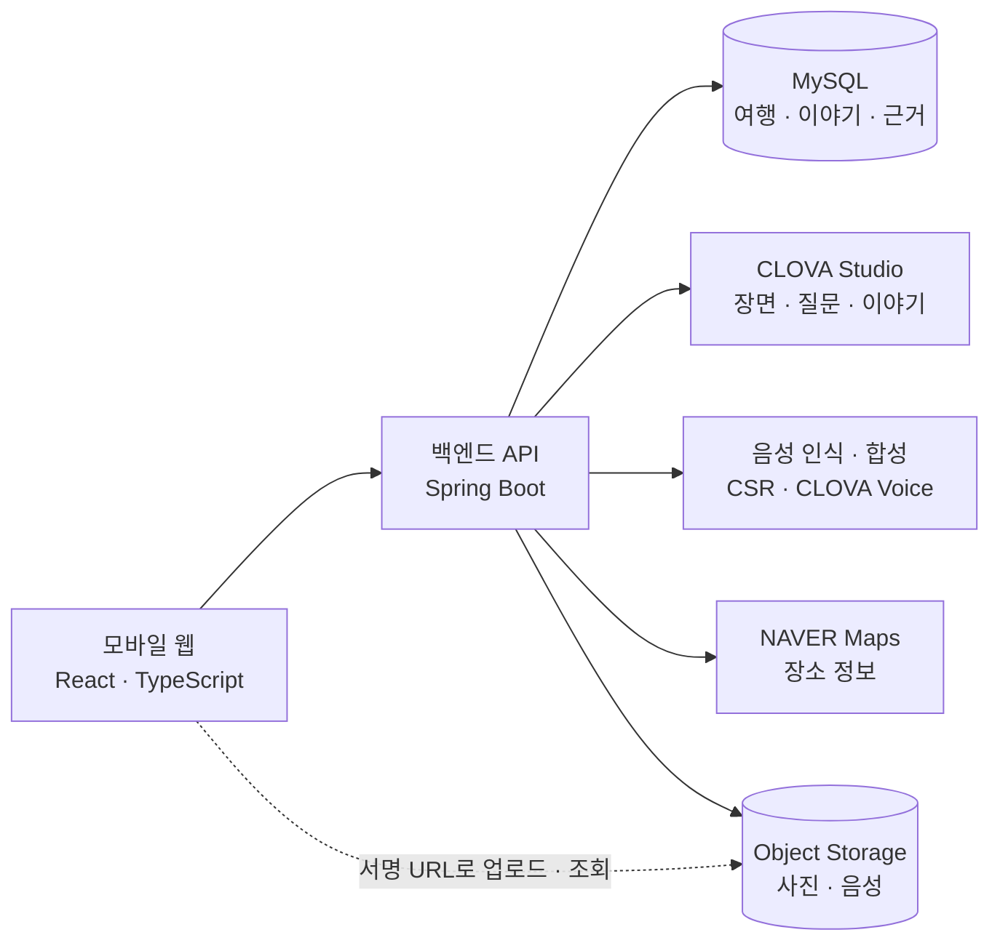

# 여행말

> 사진과 목소리가 한 권의 여행책이 됩니다.

**여행말은 여행 사진과 AI 음성 인터뷰로 나만의 여행 이야기책을 만드는 모바일 웹 서비스입니다.**

낮에는 여행을 즐기고 사진을 찍습니다. 하루를 돌아볼 때는 사진을 올리고, AI가 건네는 질문에 말로 답합니다. 여행말은 사진 속 장면과 내가 들려준 이야기를 모아 하루의 기록을 쓰고, 여행이 끝나면 한 권의 책으로 엮습니다.

[프론트엔드](https://github.com/navercloud-traveltalk/frontend) · [백엔드](https://github.com/navercloud-traveltalk/backend) · [서비스 기능 명세](https://github.com/navercloud-traveltalk/frontend/blob/main/docs/md/05_프론트엔드_기능명세서.md)

## 여행을 사진 너머의 이야기로

여행 사진에는 풍경과 음식, 함께한 사람이 남습니다. 하지만 그 음식을 고른 이유, 길을 걷다가 나눈 대화, 사진을 찍지 않았던 시간의 기억까지 담기지는 않습니다.

그 순간을 글로 남기려고 하면 어디서부터 써야 할지 막막할 수 있습니다. 여행말은 사진을 단서로 질문을 건네고, 사용자가 자신의 말로 기억을 꺼낼 수 있도록 돕습니다.

사진을 모아 보는 데서 한 걸음 더 나아가, **무엇을 봤는지와 그때 어떤 이야기가 있었는지를 함께 남기는 것**이 여행말의 목표입니다.

## 여행말을 사용하는 방법

### 1. 나만의 책장을 만들고 여행을 시작합니다

가입이나 로그인 없이 닉네임으로 책장을 만듭니다. 여행 장소와 기간, 동행 정보를 입력하면 일차별 기록을 시작할 수 있습니다.

### 2. 오늘 찍은 사진을 올립니다

사진 속 내용을 분석하고, 촬영 시각과 위치 정보가 있는 사진은 그 정보도 참고해 장면으로 묶습니다. 장면 목록에서 하루의 흐름을 돌아보고 인터뷰를 시작합니다.

사진을 찍지 않았던 시간도 기억을 이어갈 단서가 됩니다. 사진 사이의 긴 간격은 인터뷰에서 돌아볼 질문 후보로 활용합니다.

### 3. AI의 질문에 내 목소리로 답합니다

AI는 사진과 장면을 바탕으로 질문을 만들고 음성으로 들려줍니다. 사용자는 대화하듯 답하며, 사진에 담기지 않은 행동과 감정, 함께한 사람과의 기억을 덧붙입니다.

하루 인터뷰는 기본 다섯 개의 질문으로 진행합니다. 질문을 건너뛰거나, 중간에 저장하고 마칠 수도 있습니다.

### 4. 오늘의 이야기를 읽습니다

사진 설명과 인터뷰 답변을 바탕으로 하루의 이야기를 만듭니다. 일차별로 기록을 읽고, 다음 날의 이야기를 이어갑니다.

### 5. 여행의 이야기를 한 권으로 엮습니다

여행을 마치거나 지금까지의 기록을 정리하고 싶을 때 책을 만듭니다. 완성된 책은 개인 책장에 보관되며, 목차에서 원하는 일차를 골라 다시 읽을 수 있습니다.

## 주요 기능

| 기능 | 설명 |
| --- | --- |
| 사진으로 하루 돌아보기 | 사진의 장면 설명과 사용 가능한 촬영 정보를 모아 여행의 흐름을 정리합니다. |
| AI 음성 인터뷰 | 사진을 단서로 질문을 듣고, 자신의 목소리로 기억을 남깁니다. |
| 일차별 이야기 생성 | 사진과 인터뷰 답변을 바탕으로 하루의 이야기를 작성합니다. |
| 여행책과 개인 책장 | 일차별 이야기를 한 권의 책으로 엮고 여행별로 보관합니다. |
| 문장의 근거 확인 | 책의 문장을 눌러 연결된 사진과 인터뷰 답변을 확인합니다. 보관된 답변 음성이 있으면 다시 들을 수 있습니다. |
| 문체 변경 | 감성, 기록/요약, 동화 중 원하는 문체로 이야기를 읽습니다. |
| PDF로 보관 | 표지·목차·본문을 인쇄용 화면으로 열고, 브라우저의 PDF 저장 기능으로 간직합니다. |
| 기록과 음성 설정 | 인터뷰 음성과 답변 음성 보관 여부를 설정하고, 필요할 때 자신의 기록을 삭제할 수 있습니다. |

## 우리가 중요하게 생각하는 기록

### 여행자의 말이 글의 중심이 됩니다

사진은 눈에 보이는 장면을, 인터뷰 답변은 그때의 경험과 생각을 담습니다. 여행말은 두 자료를 글의 근거로 사용합니다. 사용자가 말하지 않은 감정이나 자료에 없는 사건을 덧붙이지 않도록 생성 문장을 검토하는 과정을 둡니다.

### 이야기와 원래의 기억을 함께 볼 수 있습니다

완성된 문장만 보여 주는 데서 끝나지 않고, 그 문장에 연결된 사진과 답변을 다시 확인할 수 있도록 합니다. 원본 음성을 보관한 경우에는 여행 중 남긴 목소리도 함께 들을 수 있습니다.

### 기록하는 부담을 줄입니다

긴 글을 처음부터 작성하는 대신 사진을 고르고 질문에 답하는 방식으로 시작합니다. 모바일 웹에서 사진 업로드, 음성 인터뷰, 이야기 읽기까지 이어지도록 구성했습니다.

## 기술 구성

여행말은 웹 화면과 REST API를 분리하고, NAVER Cloud Platform의 AI와 Object Storage를 연동합니다.

| 영역 | 기술 | 역할 |
| --- | --- | --- |
| 프론트엔드 | React · TypeScript · Vite | 모바일 웹 화면, 사진 업로드, 녹음·재생, 책 읽기 |
| 화면 데이터 관리 | TanStack Query · React Router | 서버 데이터 갱신, 생성 작업 상태 확인, 화면 이동 |
| 백엔드 | Java 21 · Spring Boot · Spring Data JPA | 여행·인터뷰·책 관리, AI 연동, 생성 작업 처리 |
| 데이터베이스 | MySQL 8 | 사용자·여행·장면·답변·이야기와 문장 근거 저장 |
| 생성형 AI | CLOVA Studio · HyperCLOVA X | 사진 장면 설명, 인터뷰 질문, 이야기·책 제목 생성, 문체 변경 |
| 음성 인식·합성 | CLOVA Speech Recognition · CLOVA Voice | 답변을 텍스트로 변환하고 질문을 음성으로 전달 |
| 장소 정보 | NAVER Maps Reverse Geocoding | 사진에 GPS 정보가 있을 때 좌표를 장소 정보로 변환 |
| 파일 저장 | NAVER Cloud Object Storage | 사진과 음성 저장, 서명 URL을 통한 업로드·조회 |
| 사진·음성 처리 | metadata-extractor · ffmpeg | 사진 메타데이터 추출, 음성 형식 변환 |

## 저장소 안내

| 저장소 | 내용 |
| --- | --- |
| [frontend](https://github.com/navercloud-traveltalk/frontend) | 서비스 화면, API 연동, 브라우저 녹음·재생, PDF 인쇄 화면, 프로젝트 설계 문서 |
| [backend](https://github.com/navercloud-traveltalk/backend) | REST API, 사진 분석, AI 인터뷰, 이야기 생성, 책 관리, 데이터베이스 스키마 |
| [.github](https://github.com/navercloud-traveltalk/.github) | 조직 프로필과 서비스 소개 |

## 프로젝트를 더 살펴보려면

- [서비스 화면과 사용자 시나리오](https://github.com/navercloud-traveltalk/frontend/blob/main/docs/md/05_프론트엔드_기능명세서.md)
- [아키텍처 구상도](https://github.com/navercloud-traveltalk/frontend/blob/main/docs/md/01_아키텍처_구상도.md)
- [데이터 구조와 ERD](https://github.com/navercloud-traveltalk/frontend/blob/main/docs/md/02_ERD.md)
- [API 기능 명세](https://github.com/navercloud-traveltalk/frontend/blob/main/docs/md/04_API_기능명세서.md)
- [프론트엔드 실행 방법](https://github.com/navercloud-traveltalk/frontend#readme)
- [백엔드 실행 방법](https://github.com/navercloud-traveltalk/backend#readme)

여행말은 사진 분석부터 인터뷰, 이야기 생성, 책 읽기까지 이어지는 MVP를 개발하고 검증하는 프로젝트입니다. 기능별 구현과 실행 환경에 대한 자세한 내용은 각 저장소에서 확인할 수 있습니다.

---

**사진으로 떠올리고, 말로 남기고, 책으로 다시 만나는 여행.**
